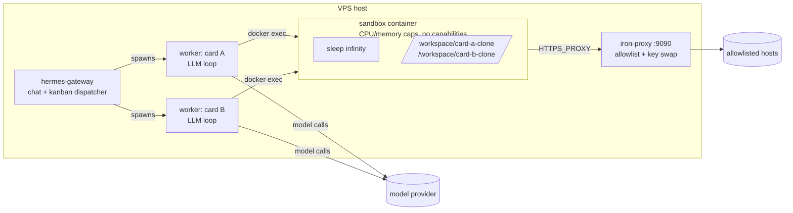

# 06 · How the Docker sandbox runs kanban workers

By now the agent works through a Hermes **kanban board**: cards go in, a dispatcher picks them up, and a worker codes, tests and opens a PR for each. Running `docker ps` on the VPS shows something puzzling:

```
CONTAINER ID   IMAGE                                 COMMAND            CREATED       STATUS
5a1e3e628c22   nousresearch/hermes-sandbox:desktop   "sleep infinity"   5 hours ago   Up 5 hours
fa83bcef7b8c   nousresearch/hermes-sandbox:desktop   "sleep infinity"   5 days ago    Up 5 days
5ea090f20872   nousresearch/hermes-sandbox:desktop   "sleep infinity"   9 days ago    Up 6 days
```

Three containers, all doing `sleep infinity`, with random names. Is there one per task? Which one is doing the work? This doc answers that from `docker inspect` and the Hermes source, and covers the night five workers ran the VPS out of memory.

Checked against Hermes Agent v0.21.7 (`tools/environments/docker.py`). Field names may change in later versions.

## 1. The brain and the hands

The most important point: **the agent itself doesn't run in the container.**

- **The brain runs on the host.** Each kanban card gets a worker: a normal Hermes process on the VPS (`python -m hermes_cli.main -p default --cli ...`). It calls the model, holds the conversation and decides the next step.
- **The hands run in the container.** When the model calls the terminal tool, the worker runs the command through `docker exec <container> bash -c "<command>"`, one call per command.



This split is the core safety pattern in agent engineering. The model only produces text that *describes* an action. Running that action is a separate step you control, so you can put limits there.

## 2. Why `sleep infinity`

A Docker container lives as long as its main process does. `sleep infinity` never exits and uses no CPU, so the container stays up and Hermes can `docker exec` into it whenever it needs. An idle sandbox uses a few MB.

The alternative, a fresh container per command, would take seconds each time and throw away installed tools and caches.

Each `docker exec` starts a fresh `bash`, so on its own `cd` and `export` wouldn't carry over between commands. Hermes saves the shell state after each command to a snapshot file (`/tmp/hermes-snap-<id>.sh`) and sources it before the next. That's how the agent's `cd` carries over.

## 3. One container per config, not per task

When a worker first needs a shell, Hermes looks for an existing container with matching **labels**:

| Label | What it holds |
|---|---|
| `hermes-agent=1` | Created by Hermes |
| `hermes-task-id` | Task key. For kanban workers it was `default` on every container. |
| `hermes-profile` | The Hermes profile (`default`). A second profile gets its own container. |
| `hermes-egress` | Fingerprint of the proxy setup. A sandbox created with the proxy on is never reused with it off. |
| `hermes-environment` | SHA-256 of the image, the mount arguments and the Hermes home folder. Change the mounts and you get a new container. |

If a container matches, Hermes reuses it, preferring a running one. Otherwise it runs `docker run -d ... sleep infinity` under a random name (`hermes-` plus 8 hex characters).

So **all cards on one profile share one container.** Cards stay apart because each worker clones the repo into its own folder under `/workspace`, not because they have separate containers.

That explains the three containers above:

| Container | What it was |
|---|---|
| 5 hours old | The active sandbox. Both running workers were `docker exec`-ing into it. |
| 5 days old | Same labels. A duplicate, most likely from two processes starting at the same moment. Idle. |
| 9 days old | An older `hermes-environment` hash from before a mount change, so nothing matches it any more. Idle. |

**Cleanup only removes exited containers.** In persistent mode Hermes leaves containers running when a process ends; stopping them would kill background jobs. At startup, an orphan reaper removes exited Hermes containers for your profile that finished more than 10 minutes ago. It never touches running ones, because one might belong to another process. Idle running duplicates stay until you remove them:

```bash
docker ps --filter label=hermes-agent=1 --format '{{.Names}} {{.RunningFor}}'
docker stats --no-stream --format '{{.Name}} {{.MemUsage}} {{.CPUPerc}}'   # the idle ones sit near 0%
docker rm -f <idle-container>                                              # when no worker is running
```

`container_cpu` and `container_memory` are not in the environment hash, so changing them may leave the old limits on a reused container. Check `docker inspect` after a change. **TODO:** confirm.

## 4. What the sandbox can and can't do

From `docker inspect` on a live sandbox:

| Setting | Effect |
|---|---|
| `--cap-drop ALL` | Root inside the container has no special Linux privileges: no mounting, no network changes |
| CPU, memory and process limits (`container_cpu`, `container_memory`, 2048 pids) | Apply to the **whole container**, which means to all workers sharing it |
| `HTTPS_PROXY` pointing at iron-proxy | Only allowlisted hosts are reachable ([04](04-docker-backend-and-composio.md)) |
| The proxy's CA certificate mounted as the system CA bundle | The proxy can inspect HTTPS traffic |
| `HERMES_PROXY_TOKEN_<KEY>` instead of the real API key | The proxy swaps in the real key on the host, so a prompt-injected agent can't leak a key it never had |
| `/workspace` and `/root` bind-mounted from `~/.hermes/sandboxes/docker/default/` | The work is on the host disk and survives crashes and container recreation |
| `~/.hermes/skills` read-only | The agent can read its skills but can't rewrite them from inside the sandbox ([05](05-github-identity-and-guardrails.md)) |

The relevant `config.yaml` keys:

```yaml
terminal:
  backend: "docker"
  container_cpu: 1          # cores, for the whole shared container
  container_memory: 5120    # MB
  container_persistent: true
  lifetime_seconds: 300     # idle timeout for a process's handle on the sandbox, not the container's life
  docker_volumes:
    - "/srv/media:/srv/media:ro"   # extra mounts, if you need them
```

## 5. Incident: five workers, one OOM kill

I released five cards at once. Every run crashed, and each retry blocked with:

```
iron-proxy is enabled but not running on port 9090. Start it with `hermes egress start`.
```

The proxy had been running for 10 days. `systemctl --user status hermes-egress` showed the real cause:

```
Active: failed (Result: oom-kill)
hermes-egress.service: A process of this unit has been killed by the OOM killer.
```

**What happened:**
- Five worker processes ran on the host, about 250 MB each.
- Five sets of `npm install` and the test runner ran in the **one shared** container.
- With the gateway on top, the 8 GB VPS, which has no swap, ran out of memory.
- The Linux OOM killer picked a process to kill, and it chose iron-proxy.
- With the proxy down, the Docker backend refuses to run commands (`enforce_on_docker`), so every worker lost its shell at once.

**Why the container's memory limit didn't help:** it limits only the container. The workers, the gateway and the proxy all run on the host, outside it.

**Fix:** limit how many cards run at once.

```yaml
kanban:
  max_in_progress: 2   # global cap on running cards
```

```bash
hermes config set kanban.max_in_progress 2
systemctl --user restart hermes-egress
systemctl --user restart hermes-gateway   # the dispatcher reads the cap at gateway start
```

After unblocking the five cards, two ran and three waited in `ready`. The crashed runs' clones were still in `/workspace`, so the new workers continued from them instead of starting over.

**What didn't work:** `OOMScoreAdjust=-900` on the egress unit, to make the kernel kill something else first. A systemd **user** unit can't lower its OOM score without privileges, so the unit fails to start. You'd need a system-level unit or a watchdog that restarts the proxy.

## 6. Lessons for agent engineering

1. **Separate deciding from doing.** The model proposes actions, and a separate layer runs them with limited permissions. Your safety limits go in that layer, not in the prompt.
2. **Control network access and keep secrets out of the sandbox.** An allowlist plus key swapping protects you better than any instruction in a prompt.
3. **Keep the work outside the throwaway parts.** Agents crash from rate limits, OOM and timeouts. If the workspace lives on the host disk, a crash costs time, not work.
4. **Limit how much runs at once.** One agent looks cheap; several running at once can take down shared parts of the system, like the egress proxy here. Set the cap before you need it.
5. **Make every setting traceable.** Labels, config hashes and a config repo that matches the server turned "everything is broken" into a few minutes of reading.

## Check your understanding

1. You add a second Hermes profile and give it a card. Does it share the existing sandbox? Which label decides?
2. You change `container_cpu` from 1 to 2 and restart. Does the next worker get a new container? (Look at what goes into the environment hash.)

## Next

- **TODO:** remove the idle duplicate containers, then try `container_cpu: 2` on a 4-core VPS.
- **TODO:** add 2 to 4 GB of swap, so a memory spike slows the VPS down instead of killing a process.
- Further reading: cgroups (how container limits work), gVisor and Firecracker (stronger isolation than Docker), and the "lethal trifecta" for prompt injection (private data + untrusted input + a way to send data out).
